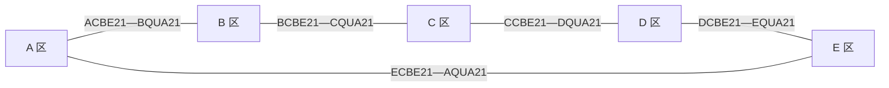

# 石家庄万节点研究扩展算例

生成与验证日期：2026-10-19。该算例用于规模扩展和互联潮流实验；原始石家庄 DAT / XLS 均不改动。总共保留五份网络，母线数由原始规模决定，没有为凑整 10,000 而删除节点。

五十份网络的十万节点版本已另行实现，构造与实测见[十万节点扩展算例说明](十万节点扩展算例说明.md)。本说明中的 ×5 文件和结果继续保留。

当前默认算法已更新为实际参与交流边界协调的分区并行牛顿法；本页保留构造说明和早期试算记录。新的实现、四种算法一致性测试及十万节点公平对照见[配网分区并行求解与基准](配网分区并行求解与基准.md)。

## 连接规则

五个区域为 A、B、C、D、E。每区母线名在原名之前增加一个区域字母，所有内部线路、变压器、负荷、额定值、阻抗和固定分接参数按原始卡片复制。

默认新增 5 条 230 kV 联络线：



上述连线仅表达接线关系；潮流方向由计算结果决定。五份网络构成一个交流连通分量，并使用一个全网角度参考。`--connection chain` 可生成 A—B—C—D—E 链式连接，新增 4 条联络线。

## 新增参数与控制假设

联络线采用原始 QUA21—CBE21 第一条 L 卡的参数：R = 0.0007 pu、X = 0.0049 pu、每侧并联电纳 = 0.0093 pu，基准容量 1000 MVA，额定电流 1380 A；在模型基准电压 230 kV 下额定容量为 549.752926 MVA。来源是 13 点 DAT 第 291 行、20 点 DAT 第 290 行。原有线路仍保留，新增联络线仅复用其参数作为研究假设，不声称为实地线路。

A 区 AVOE21 保留 BS；B～E 区原 BS 改为 BE，保留原卡的有功给定、电压目标及其他数值字段，去掉固定相角字段。所有改动在 DAT 第一行元数据和同名 `.manifest.json` 中列出。原始数据没有这些互联运行方式。

20 点需要特别结合这一控制假设理解：原始 BS 卡给定 P=207.9 MW，而独立原网求解出的平衡节点净有功为约 −55.44 MW。转成 BE 后，复制区域的 P=207.9 MW 成为固定给定，额外功率需要经联络线交换并由 A 区平衡节点吸收。此次扩展计算 AVOE21 约为 −1107.32 MW。这是“保留原 P 给定”的扩展工况结果，不是对真实电源调度的确认。

## 试算结果

以下为普通牛顿法本机实测。总耗时包含解析、分区、全网求解、固定边界子网校核及结果整理，不含浏览器渲染和结果下载；时间会随机器负载变化。

| 算例 | 母线 | 支路 | 全网迭代 | 数值求解 | 任务计算总耗时 | 原始节点残差 MVA | 分区通过 |
| --- | ---: | ---: | ---: | ---: | ---: | ---: | ---: |
| 13 点 ×5 | 10,605 | 10,640 | 4 | 160.9 ms | 2012.3 ms | 4.078e-06 | 295 / 295 |
| 20 点 ×5 | 10,610 | 10,650 | 4 | 155.1 ms | 1980.2 ms | 3.447e-06 | 295 / 295 |

每个算例有 455 条 T 卡支路和 295 个配网分区。原来的 6 个假设微网接入点随区域复制成为 30 个展示点；未增加微网内部网架或额外注入。

## 联络线结果

有功正方向为表中“起点 → 终点”，负值表示反向。负载率采用两侧电流口径。

| 断面 | 联络线 | 首端 P / MW | 首端 Q / Mvar | 电流负载率 |
| --- | --- | ---: | ---: | ---: |
| 13 点 | ACBE21 → BQUA21 | 36.228 | 48.434 | 13.845% |
| 13 点 | BCBE21 → CQUA21 | 37.795 | 48.195 | 13.945% |
| 13 点 | CCBE21 → DQUA21 | 39.363 | 47.966 | 14.051% |
| 13 点 | DCBE21 → EQUA21 | 40.930 | 47.737 | 14.163% |
| 13 点 | ECBE21 → AQUA21 | 42.498 | 47.497 | 14.277% |
| 20 点 | ACBE21 → BQUA21 | -453.457 | 56.999 | 82.659% |
| 20 点 | BCBE21 → CQUA21 | -190.300 | 17.068 | 34.822% |
| 20 点 | CCBE21 → DQUA21 | 73.030 | -20.961 | 13.660% |
| 20 点 | DCBE21 → EQUA21 | 336.387 | -58.777 | 61.394% |
| 20 点 | ECBE21 → AQUA21 | 599.629 | -98.021 | 109.235% |

20 点 E→A 联络线约 109.235%，过载按结果保留。节点方程收敛、分区一致性通过和设备是否越限分别判断，未通过调整阻抗、降低负荷或放大容量压低过载。

## 使用和追溯

```bash
python tools/build_expanded_case.py
python tools/build_expanded_case.py --hour 13 --copies 5 --connection chain --output-dir runtime/chain_cases
python start_api.py
```

在网页的数据断面下拉框选择“研究扩展 · 13 点 ×5”或“研究扩展 · 20 点 ×5”，再选择算法并运行。默认启动仍为原始 13 点断面。拓扑按五个区域分组布局，绿色粗线表示新增联络线；节点详情显示区域和原始母线名。画面坐标是电气布局，不能当作真实 GIS。

- `gmss/expansion.py`：生成规则及区域布局。
- `tools/build_expanded_case.py`：可重复生成的命令入口。
- `data/synthetic/*.dat`：扩展输入，首行包含完整构造元数据。
- `data/synthetic/*.manifest.json`：源文件、生成文件 SHA-256、控制变更和联络线参数。
- `runtime/expanded/summary.json`：本次试算摘要；同目录保存两断面普通牛顿法完整结果。
- `runtime/runs/<task_id>/`：从网页执行的真实任务结果和事件日志。

自动验证包括：原始 21 个 DAT / XLS 文件哈希不变；内部参数逐字段一致；唯一母线标识；一个连通分量、一个 BS；三种算法在两个万节点算例上均收敛且结果一致；295 个分区全部通过；联络线上存在非零有功交换；过载不截断。

2026-10-19 完整自动测试共 21 项通过。随后对实际 4173 服务进行浏览器验证：两个扩展算例分别实际运行、点击母线及联络线、查看 10,640 / 10,650 行支路表和 295 行分区表、筛选端点、切回原始断面，以及 390 像素移动视口，均通过且没有页面脚本错误。浏览器端从点击到本次结果显示约 3.03 / 2.70 秒，摘要位于 `runtime/expanded/browser_validation.json`。原有断面三种算法、文件夹上传、节点持续更新、失败反馈与日志下载的浏览器回归也通过。
