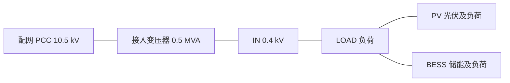

# 微网独立子系统：建模依据与验证

日期：2026-10-29。适用范围：当前 Python 求解器、HTTP 服务和网页；历史报告保留其当时的模型口径。

## 微网是不是一个节点

通常不是。DOE 的定义是：明确电气边界内互联的负荷和分布式能源，对外作为一个可控实体，可以接入和脱离电网以支持并网及孤岛运行。“一个可控实体”指控制与接口层面的整体，不表示内部只有一条母线。PCC 是公共耦合点，不能单凭一个 PCC 标签认定存在微网。

直接核查的资料：

1. Dan T. Ton / Merrill A. Smith, *The U.S. Department of Energy's Microgrid Initiative*, The Electricity Journal 25(8), 2012，p.84。原文包括 “a group of interconnected loads and distributed energy resources within clearly defined electrical boundaries” 和 “single controllable entity”。[DOE 官方 PDF](https://www.energy.gov/sites/default/files/2016/06/f32/The%20US%20Department%20of%20Energy%27s%20Microgrid%20Initiative.pdf)，[DOI](https://doi.org/10.1016/j.tej.2012.09.013)。该定义还要求并网／孤岛能力，本项目的单断面潮流不能验证这项动态能力。
2. CIGRE Task Force C6.04.02, *Benchmark Systems for Network Integration of Renewable and Distributed Energy Resources*, 2014。已直接读取 [pandapower 的公开实现](https://github.com/e2nIEE/pandapower/blob/9361610ce353e23649ed2c3c80f93ab4abedafb7/pandapower/networks/cigre_networks.py)。其中 `create_cigre_network_lv` 展开了住宅、工业和商业多条母线、线路、负荷和变压器；`create_cigre_network_mv` 支持光伏、风电、储能等 DER。它说明公开配电／DER 研究网络通常保留内部网架；CIGRE 配电基准本身并不证明本项目的候选站点是现场微网。

在只研究外部电网且有等值依据时，可以把微网表示为一个端口或聚合节点。但是固定 PQ 的单节点注入不能自动保留内部压降、线路损耗、设备限值及电压变化引起的端口响应。本次采用保留内部网架的多节点稳态研究模型；求解每轮对内部未知量作 Schur 消元，得到当前线性化问题的边界等值。这个线性化等值不等同于一个在所有工况下均精确的固定 PQ 节点。

## 本次模型与假设

用户确认采用多节点研究模型。QRTY2、QRTY1、OBFY1、FUNY2、LQTY1、LAJY1 继续作为原配网 PCC；各 PCC 后新增一个独立微网，原站点已有馈线不重新命名为微网。六个接入位置及其微网身份是研究假设，非现场确认。

每个微网的拓扑如下；PCC 不计入四个内部母线。MG 编号按 DAT 母线顺序生成，不依赖配网分区编号。



| 项目 | 当前参数 | 来源及处理 |
|---|---|---|
| 接入变压器 | 0.5 MVA，10.5/0.4 kV；设备基准 R=0.01、X=0.04 pu | 容量及阻抗参考 CIGRE LV 住宅变压器；高压侧从 20 kV 改为本地 PCC 电压，固定 tap=1、相移=0 均属研究假设；原基准中的 30° 相移未复制 |
| 电缆 | R=0.162 Ω/km，X=0.0832 Ω/km | 参考 CIGRE LV 的 UG1；三条长度 35/30/25 m、额定电流 0.3 kA 是研究假设，未复制完整 CIGRE 线路 |
| 内部总负荷 | 0.20 MW，0.07 Mvar | 三个负荷点的研究给定，全部是新增负荷，不从原 DAT 扣减 |
| 光伏 | P=0.10 MW，Q=0，S额定=0.12 MVA | 研究调度给定，按并网 PQ 注入；此处 PV 是光伏设备名称，母线类型仍为 PQ |
| 储能 | P=0.02 MW，Q=0.015 Mvar，S额定=0.15 MVA，P绝对值≤0.10 MW | 研究调度给定，正 P 为放电；检查给定是否在设备视在功率和有功范围内，不模拟 SOC 时间演化 |
| 控制 | 各微网按统一的固定 PQ 调度给定运行 | 属于微网并网单断面模型；没有新增 BS，原电网仍提供统一相角基准 |

模板位于 [`data/microgrid/default_template.json`](../data/microgrid/default_template.json)，建模代码位于 [`gmss/microgrid.py`](../gmss/microgrid.py)。源参数、假设说明和参考链接随结果返回。DAT 注释记录写入时的参数模板 SHA-256，运行结果记录实际输入 DAT 的 SHA-256。模板仅用于一次性生成设备卡片，求解不读取模板补充设备。

采用三相平衡、正序稳态模型。没有提供现场内部设备台账，不能称为“现场微网还原模型”，也没有验证孤岛运行、构网控制、保护、动态稳定或不平衡三相运行。它可称为“微网并网稳态的多节点等效研究模型”。数学与数值验证通过，不代表这些研究参数已获得现场验证。

接入后每个微网计划净需电为 0.08 MW、0.055 Mvar，实际 PCC 交换还需计入变压器和内部线路损耗。新增 L 卡 R/X 已换算到 DAT 系统基准；新增 T 卡 R/X 明确按 100 MVA 写入（R=2、X=8 pu），子系统注释记录这一明确基准，解析时换算一次。在当前 1000 MVA 系统基准下，接入变压器 R=20、X=80 pu，与 0.5 MVA 设备基准的 R=0.01、X=0.04 pu 等价。

## 独立计算域与边界交换

- 微网四个内部母线被固定为一个独立计算域，不能被 METIS 混进配网域；PCC 属于父配网域。结果包含 `partition_id`、`parent_partition_id`、内部母线及设备。
- 每轮从当前电压计算 AC 方程。微网和配网分别消元内部雅可比块，返回 Schur 系数及不平衡量；协调器更新跨域边界电压，再回代各区内部电压。跨域支路两端的未知量均保留在协调器，包括微网接入变压器的低压入口。
- 物理接口可读作：配网给微网 PCC 的 V/θ；微网反馈该电压状态下的进口 P/Q 和线性化响应。P/Q 来自微网网架、设备及边界方程，不能与边界电压同时任意指定为独立未知量。原 PCC 为 PV 时继续保持原幅值目标，其相角及所需无功按原控制参与求解。
- 使用共享 Schur 协调器的耦合 Newton 迭代，已经包含微网内部方程与反馈；没有另外伪造一层固定点循环或固定边界的全网解后复算。普通 NR 则集中式求解同一个新增微网后的模型，用于对照。

逐轮 `microgrid_states` 和最终 `scenario.microgrids` 给出 PCC V/θ、微网入口 V/θ、进口 P/Q、实际接收 P/Q、损耗、入口 P/Q 残差、全部内部 AC 方程残差及功率平衡误差。

`import_p_mw` / `import_q_mvar` 正值表示从配网进入微网，负值表示反送。`received_*` 是变压器低压侧收到的功率，`loss_*` 包含接入变压器和内部线路。校验式为：

```
P_import = P_load - P_generation + P_loss
Q_import = Q_load - Q_generation + Q_loss
```

入口残差来自微网 IN 母线的 P/Q 节点方程，而非强制变压器两端功率和为零。两端和包含损耗，不能当作边界未收敛残差。共享边界电压本身没有重复副本，电压连续由组装结构保证。

## 数据存储、页面与接口

按用户要求，已直接修改 `raw_dataset/extracted/13点sim2合并anony.dat` 和 `20点sim2合并anony.dat`，各新增 24 条 B 卡、18 条 L 卡和 6 条 T 卡。当前分别为 2,145 / 2,146 母线、2,151 / 2,153 支路，均含 97 台变压器及 6 个微网。原有设备卡片保持不变，新增卡片插入 `/SOLUTION` 前。

修改前文件按内容哈希保存在 [`data/backups/before_microgrid/`](../data/backups/before_microgrid/)，修改记录见 [`manifest.json`](../data/backups/before_microgrid/manifest.json)。`doc/repository_cleanup.json` 是历史清理记录，其中原 DAT 哈希对应这些备份。19 份 XLS 不修改。已有上传中与修改前标准 DAT 字节完全一致的副本同步更新；自定义数据不自动变更。

B/L/T 卡包含实际电气设备及 P/Q。`.GMSS_MICROGRID` 注释只标记子系统归属、设备限值、参数来源及接入变压器阻抗基准；`read_dat` 不添加设备，`microgrids_from_dat` 从已解析卡片取得调度与负荷，修改 B 卡即可改变实际潮流。新增设备均为 `source_dat`，有真实 `input_source_line`。

网页、`run_case`、原始求解器和 HTTP 接口统一直接读取 DAT，不提供微网建模选项或运行时叠加参数。“微网子系统”图层包含内部线路和母线；分析页点击微网结果行可放大内部网架；点击 PCC 或内部母线可查看逐轮交换和内部残差。复算修改前工况时显式选择备份文件即可，不通过页面模式切换。

## 验证

测试位于 [`tests/test_microgrid.py`](../tests/test_microgrid.py) 及 HTTP 集成测试。验证覆盖两个断面、四种算法、独立域归属、实际参与局部消元的线程记录、全部节点 KCL、含损耗功率平衡、反送电、储能充电、微网负荷扰动向配网反馈、求解不改写 DAT、一次性写入的幂等性、设备卡片独立完整性、明确变压器基准及原拓扑坐标保留。

重复命令：

```bash
/home/y/miniconda3/envs/powerflow/bin/python -m unittest discover -s tests -v
```

57 项回归测试全部通过。最新数值结果见 [`reports/微网子系统验证.json`](reports/微网子系统验证.json)，其中记录实际 DAT 哈希、两个断面的四算法对比、全节点 KCL 残差、微网功率平衡和迭代残差。Chrome 检查覆盖上传、默认运行、微网内部视图、逐轮回放及重复运行。测试只验证当前明确的并网稳态范围，不能代替现场设备及孤岛控制验证。
